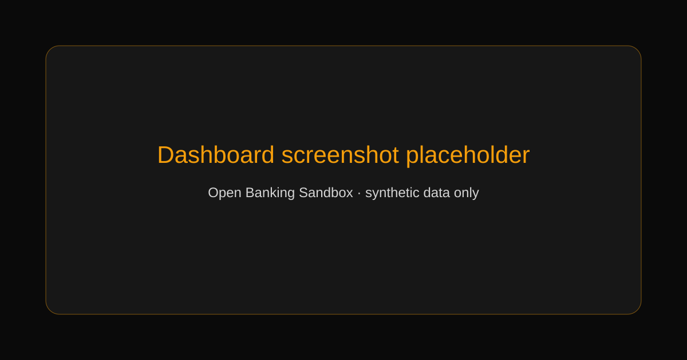

# Open Banking Sandbox

[](https://github.com/TrinaxCode/open-banking-sandbox/actions/workflows/ci.yml)
[](LICENSE)
[](https://nextjs.org/)
[](https://www.typescriptlang.org/)

An educational full-stack banking simulation built with Next.js, TypeScript, Prisma, and NextAuth.js. The user interface is branded as **Trinax Bank** and includes bilingual English/Spanish flows, realistic account operations, and a security-focused server-side domain model.

> This project does not handle real money, connect to financial institutions, or provide financial advice. Use it only with synthetic data.



## Table of contents

- [Features](#features)
- [Technology](#technology)
- [Architecture](#architecture)
- [Getting started](#getting-started)
- [Demo account](#demo-account)
- [Available scripts](#available-scripts)
- [Configuration](#configuration)
- [Testing](#testing)
- [Security](#security)
- [Screenshots and demo](#screenshots-and-demo)
- [Troubleshooting](#troubleshooting)
- [Roadmap](#roadmap)
- [FAQ](#faq)
- [Contributing](#contributing)
- [Credits](#credits)
- [License](#license)

## Features

- Multiple checking, savings, and credit accounts.
- Deposits, withdrawals, internal transfers, and external transfers.
- Transaction history with search, filters, categories, date ranges, and CSV export.
- Spending analytics and six-month income/spending trends.
- Savings goals with contributions, deadlines, and atomic refunds on deletion.
- Beneficiaries for reusable transfer destinations.
- Scheduled daily, weekly, and monthly transfers.
- In-app notifications and per-user notification preferences.
- Responsive dark glass UI with English and Spanish translations.
- Input validation, rate limiting, bcrypt password hashing, secure cookies, and security headers.

## Technology

| Layer | Tools |
| --- | --- |
| Application | Next.js 15 App Router, React 18, TypeScript |
| UI | Tailwind CSS, CSS animations, Recharts |
| Data | Prisma ORM with SQLite for development and PostgreSQL-compatible production configuration |
| Authentication | NextAuth.js credentials provider with JWT sessions |
| Validation | Zod |
| Testing | Vitest, Testing Library, Playwright |

## Architecture

```text
Browser
  -> Next.js App Router and protected dashboard routes
  -> Server Actions in src/lib/actions.ts
  -> Zod validation and authentication checks
  -> Prisma ORM
  -> SQLite (development) or PostgreSQL-compatible database
```

Business rules are kept in `src/lib`, reusable UI lives in `src/components`, the Prisma schema and demo data are under `prisma/`, and end-to-end coverage lives in `e2e/`.

## Getting started

### Requirements

- Node.js 20.19 or newer.
- npm 10 or newer.

### Installation

```bash
git clone https://github.com/TrinaxCode/open-banking-sandbox.git
cd open-banking-sandbox
npm install
cp .env.example .env
npx prisma db push
npm run db:seed
npm run dev
```

Open <http://localhost:3000>.

### Demo account

`npm run db:seed` creates synthetic data for local exploration:

| Field | Value |
| --- | --- |
| Email | `demo@banking.app` |
| Password | `demo-password` |

These credentials are intentionally public demo data. Never reuse them in a real deployment.

## Available scripts

| Command | Purpose |
| --- | --- |
| `npm run dev` | Start the development server. |
| `npm run build` | Create a production build. |
| `npm start` | Serve the production build. |
| `npm run lint` | Run the Next.js ESLint rules. |
| `npm run typecheck` | Run the strict TypeScript compiler check. |
| `npm run test:run` | Run the unit and integration tests once. |
| `npm run test:coverage` | Generate the test coverage report. |
| `npm run test:e2e` | Run Playwright end-to-end tests. |
| `npm run db:push` | Apply the Prisma schema to the configured database. |
| `npm run db:seed` | Reset and seed the local database with demo data. |
| `npm run db:studio` | Open Prisma Studio. |

## Configuration

Copy `.env.example` to `.env` and set values for your environment:

| Variable | Description |
| --- | --- |
| `DATABASE_URL` | Prisma database URL. SQLite is the default for development. |
| `NEXTAUTH_URL` | Canonical URL where the application runs. |
| `NEXTAUTH_SECRET` | Long random value used to sign and encrypt NextAuth data. |

Generate a production secret with `openssl rand -base64 32`. Environment files, databases, logs, and build output are ignored by Git.

## Testing

The repository currently includes 122 unit and integration tests covering authentication, validation, money handling, database helpers, rate limiting, analytics, server actions, and key UI components. Coverage output is informational; the release gate is type-checking, linting, tests, and a production build.

Run the local release checks with:

```bash
npm run typecheck
npm run lint
npm run test:run
npm run build
```

Playwright tests require a running app and browser binaries. They are available for local verification but are not required for the fast CI job.

## Security

Security is part of the demo's design, but this is not a production banking system. The application includes input validation, guarded balance updates, generic invalid-destination errors, anti-enumeration password comparison, in-memory rate limiting, secure cookie settings, and baseline security headers.

Known boundaries:

- The in-memory rate limiter is suitable for a single demo process; use a shared store before deploying multiple instances.
- SQLite is a development default; use a managed PostgreSQL-compatible database for production experiments.
- Scheduled transfers are executed when the dashboard loads; connect them to a trusted scheduler before treating them as background jobs.
- No real payment rails, KYC, compliance, fraud detection, or financial integrations are included.

Please report vulnerabilities privately as described in [SECURITY.md](SECURITY.md). Do not open an issue containing credentials or exploit details.

## Screenshots and demo

The repository intentionally includes placeholders until final media is selected:

- Dashboard screenshot: `docs/assets/dashboard-placeholder.svg`
- Product GIF: `docs/assets/demo-placeholder.svg`
- Hosted demo: not available yet; run the app locally.

## Troubleshooting

### Prisma cannot connect

Confirm that `.env` exists and `DATABASE_URL` is valid. For the default setup, run `npx prisma db push` again.

### Login fails after changing the schema

Recreate the synthetic database with `npm run db:seed`. This resets local demo data.

### The build reports a missing secret

Set `DATABASE_URL`, `NEXTAUTH_URL`, and `NEXTAUTH_SECRET` in `.env`. Never commit the file.

### Playwright cannot launch

Install the browser binaries with `npx playwright install` and ensure the development server is available at `http://localhost:3000`.

## Roadmap

- Add a shared rate-limit adapter for multi-instance deployments.
- Add a documented PostgreSQL migration workflow.
- Add accessibility-focused end-to-end coverage.
- Add a background worker example for scheduled transfers.
- Publish an optional hosted demo populated only with synthetic data.

## FAQ

### Is this a real bank?

No. It is a local educational simulation. It must not be used for real financial activity.

### Can I use PostgreSQL?

Yes. Set `DATABASE_URL` to a PostgreSQL connection string and use a migration workflow appropriate for your deployment.

### Can I remove the bilingual UI?

Yes. Translation strings are centralized in `src/lib/i18n.ts`; contributions that preserve the existing English and Spanish behavior are welcome.

### Why is the demo password in the README?

It is synthetic seed data for local development only. Production credentials must come from a secure secret-management system.

## Contributing

Bug reports, documentation improvements, tests, and focused code changes are welcome. Read [CONTRIBUTING.md](CONTRIBUTING.md) before opening an issue or pull request.

## Credits

Created and maintained by [TrinaxCode](https://github.com/TrinaxCode).

Thanks to the Next.js, Prisma, NextAuth.js, React, Tailwind CSS, Vitest, Testing Library, and Playwright communities for the open-source tools used here.

## License

Released under the [MIT License](LICENSE).
