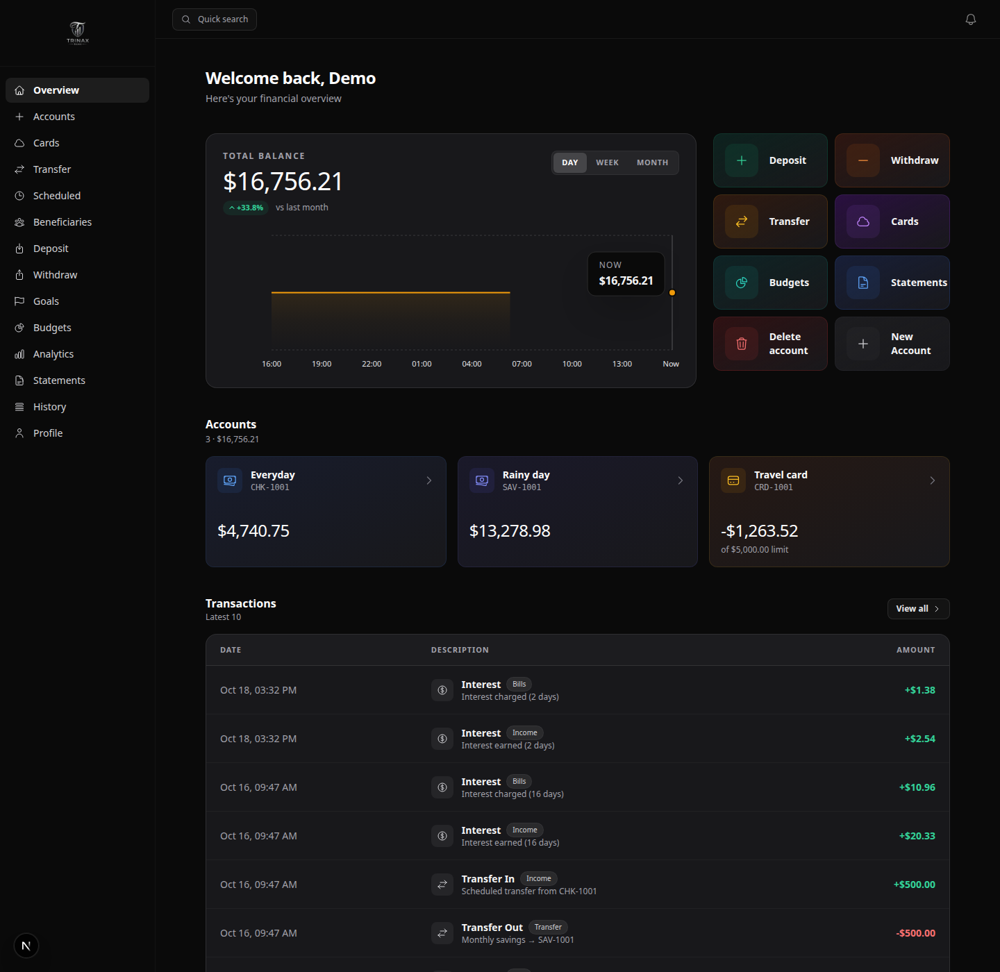
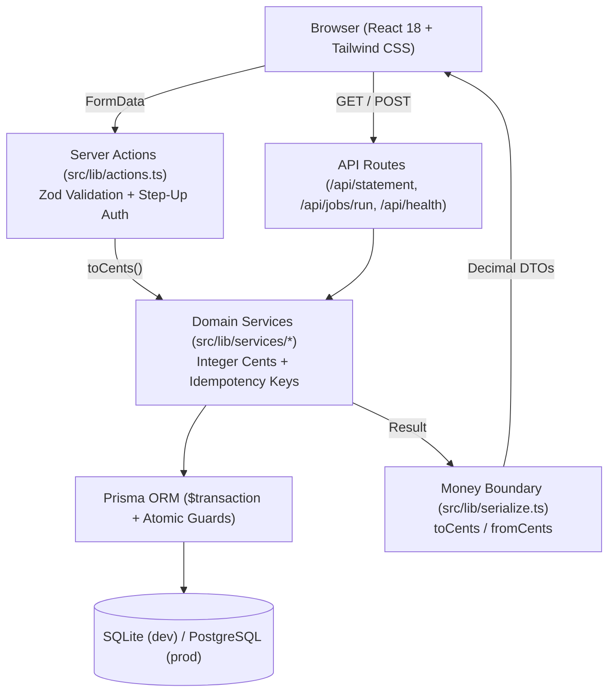
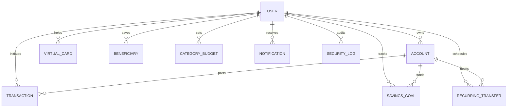

# Open Banking Sandbox

[](https://github.com/TrinaxCode/open-banking-sandbox/actions/workflows/ci.yml)
[](LICENSE)
[](https://nextjs.org/)
[](https://www.typescriptlang.org/)

An educational full-stack banking simulation built with Next.js, TypeScript, Prisma, and NextAuth.js. The user interface is branded as **Trinax Bank** and includes bilingual English/Spanish flows, realistic account operations, and a security-focused server-side domain model.

> This project does not handle real money, connect to financial institutions, or provide financial advice. Use it only with synthetic data.



[Open the live demo](https://trinaxbank.vercel.app)

## Table of contents

- [Features](#features)
- [Technology](#technology)
- [Architecture](#architecture)
- [Getting started](#getting-started)
- [Demo account](#demo-account)
- [Available scripts](#available-scripts)
- [Configuration](#configuration)
- [Testing](#testing)
- [Security](#security)
- [Screenshots and demo](#screenshots-and-demo)
- [Troubleshooting](#troubleshooting)
- [Roadmap](#roadmap)
- [FAQ](#faq)
- [Contributing](#contributing)
- [Credits](#credits)
- [License](#license)

## Features

Each item below is a screen or module in this repository.

- Checking, savings, and credit accounts, with a savings rate, a credit line, and
  a payment due day. Open one from `/dashboard/accounts/new`.
- Deposits, withdrawals, transfers between your own accounts, and transfers to
  another account number. A flat fee applies only when the money leaves you.
  Monetary mutations support **idempotency keys (`idem:<key>`)** so retries or
  duplicate submissions never double-debit or double-credit an account.
- **Step-up password verification** on high-value external transfers that meet or
  exceed the user's configured large-transaction threshold (`largeTxThreshold`),
  with failed attempts recorded in the security log.
- Monthly spending limits per category at `/dashboard/budgets`. Each card shows
  spent, limit, remaining, and a bar that turns amber near the limit and rose
  once you pass it.
- Monthly statements at `/dashboard/statements`: opening balance, each movement,
  fees, interest, and a closing balance you can print or export as **CSV** or **JSON**.
- A currency converter for USD, EUR, GBP, MXN, CAD, JPY, CHF, and BRL. The rates
  are fixed sandbox numbers, not a live market feed. Open it from the command
  palette.
- A bill splitter in the same palette: people, a tip percent, and a share you can
  copy.
- A profile activity list for sign-in, card, password, and budget changes, with
  the request IP when the server has one, plus a **GDPR / Personal Data JSON export**
  archive button in `/dashboard/profile`.
- A note on each transaction, edited from the transaction detail.
- A command palette (`⌘K` / `Ctrl+K`) that jumps to the main screens and opens
  the converter and the splitter.
- A printable transaction detail, with the reference copied from that dialog.
- Virtual cards at `/dashboard/cards`: create, show or hide the number, copy it,
  freeze, unfreeze, and **simulate merchant purchases** against any account (enforcing
  freeze status, expiration dates, and `maxUses` quotas while auto-categorizing the expense).
- Amount shortcuts on the transfer form and on savings-goal contributions.
- A "fill demo" button on the login form that types the seed email and password.
- Interest posted by a background job: savings balances earn, credit-card debt
  is charged, each as its own ledger row.
- Transaction history with server-side search, filters, date ranges, pagination
  and CSV export.
- Spending analytics, category breakdown, daily average metrics, and six-month income/spending trends.
- Savings goals with contributions, deadlines, and atomic refunds on deletion.
- Beneficiaries for reusable transfer destinations.
- Scheduled daily, weekly, and monthly transfers, executed by a throttled job
  runner or an external scheduler (`POST /api/jobs/run`). They use the same
  external-transfer fee as manual transfers; transfers to your own accounts
  remain free, and the balance must cover the amount plus the fee.
- In-app notifications with "mark all as read" and per-user preferences.
- **Bilingual UI (English/Spanish)** with typed translations, a locale that is
  resolved on the server, and dates and numbers formatted for the active locale.
- Input validation, rate limiting, bcrypt password hashing, secure cookies,
  Content Security Policy and baseline security headers.
- **Money is stored in integer cents** end to end, so balances cannot drift.

## Technology

| Layer          | Tools                                                                                     |
| -------------- | ----------------------------------------------------------------------------------------- |
| Application    | Next.js 15 App Router, React 18, TypeScript                                               |
| UI             | Tailwind CSS, CSS animations, Recharts                                                    |
| Data           | Prisma ORM with SQLite for development and PostgreSQL-compatible production configuration |
| Authentication | NextAuth.js credentials provider with JWT sessions                                        |
| Validation     | Zod                                                                                       |
| Testing        | Vitest, Testing Library, Playwright, axe-core                                             |

## Architecture



### Entity-Relationship Model



Key architectural decisions are documented in [docs/adr/](docs/adr/README.md):

- [ADR-0001: Integer-Cents Money Boundary & Atomic Balance Guards](docs/adr/0001-integer-cents-money-boundary.md)
- [ADR-0002: Compile-Time Verified Server-First Bilingual i18n](docs/adr/0002-typed-server-first-i18n.md)
- [ADR-0003: Opportunistic Due-Jobs Engine & Idempotent Ledger Mutations](docs/adr/0003-throttled-background-jobs-and-idempotency.md)

Two rules keep this honest:

1. **One implementation of the business logic.** Server actions are thin
   adapters: they validate with Zod, call a service, and translate the result into
   `{ error }` / `{ success }` for the form that called them. Nothing about money is
   written twice.
2. **One money boundary.** The database, the services and the API work in integer
   cents; React components receive decimal currency units. The conversion happens
   exactly once, in `src/lib/serialize.ts`, called by the loaders in
   `src/lib/queries.ts`. Components never see cents, services never see dollars.

Value sets that a database enum would normally enforce (account types, transaction
types, statuses, frequencies) live in `src/lib/domain.ts`: the SQLite connector
does not support Prisma `enum`, so they are enforced by Zod in the service layer
instead.

A third rule keeps the two languages honest: **every user-facing string comes from
the dictionary** in `src/lib/i18n`. `en.ts` is the reference, `es.ts` is typed
against it, `t()` only accepts keys that exist, and labels built from domain values
go through the typed maps in `src/lib/i18n/labels.ts` instead of template strings.
The chosen locale lives in a cookie that the root layout reads, so the server
renders the right language (and `<html lang>`) on the first paint.

Business rules live in `src/lib`, reusable UI in `src/components`, the Prisma
schema and demo data under `prisma/`, and end-to-end coverage in `e2e/`.

## Getting started

### Requirements

- Node.js 20.19 or newer.
- npm 10 or newer.

### Installation

```bash
git clone https://github.com/TrinaxCode/open-banking-sandbox.git
cd open-banking-sandbox
npm install
cp .env.example .env
npm run db:deploy   # apply the versioned migrations
npm run db:seed     # synthetic accounts, transactions and history
npm run dev
```

Open <http://localhost:3000>.

The schema is managed with versioned migrations (`prisma/migrations`), so
`npm run db:deploy` is the deploy-time command and `npm run db:migrate` creates a
new migration while developing. `npm run db:reset` drops everything, replays the
migrations and re-seeds.

### Running with Docker

You can also build and run the production container with Docker Compose:

```bash
docker compose up --build
```

The container automatically runs `npx prisma migrate deploy` on startup and exposes the app at <http://localhost:3000> with a healthcheck against `/api/health`.

### Demo account

`npm run db:seed` creates synthetic data for local exploration:

| Account         | Email               | Password        | Purpose                                                                                      |
| --------------- | ------------------- | --------------- | -------------------------------------------------------------------------------------------- |
| Primary         | `demo@banking.app`  | `demo-password` | Three accounts, virtual cards, history, a goal, beneficiaries, a schedule, budgets, and logs |
| Peer (receives) | `alice@banking.app` | `demo-password` | Makes external transfers meaningful                                                          |

These credentials are intentionally public demo data. Never reuse them in a real deployment.

## Available scripts

| Command                 | Purpose                                                 |
| ----------------------- | ------------------------------------------------------- |
| `npm run dev`           | Start the development server.                           |
| `npm run build`         | Create a production build.                              |
| `npm start`             | Serve the production build.                             |
| `npm run lint`          | Run ESLint (Next.js plus accessibility rules).          |
| `npm run format`        | Format the repository with Prettier.                    |
| `npm run format:check`  | Verify formatting without writing (used in CI).         |
| `npm run typecheck`     | Run the strict TypeScript compiler check.               |
| `npm run test:run`      | Run the unit and integration tests once.                |
| `npm run test:coverage` | Coverage report; fails under the configured thresholds. |
| `npm run test:e2e`      | Run Playwright end-to-end and accessibility tests.      |
| `npm run db:migrate`    | Create and apply a migration during development.        |
| `npm run db:deploy`     | Apply pending migrations (deployments and CI).          |
| `npm run db:reset`      | Drop, re-migrate and re-seed the database.              |
| `npm run db:seed`       | Re-seed demo data.                                      |
| `npm run db:studio`     | Open Prisma Studio.                                     |

## Configuration

Copy `.env.example` to `.env` and set values for your environment:

| Variable                      | Description                                                         |
| ----------------------------- | ------------------------------------------------------------------- |
| `DATABASE_URL`                | Prisma database URL. SQLite is the default for development.         |
| `NEXTAUTH_URL`                | Canonical URL where the application runs.                           |
| `NEXTAUTH_SECRET`             | Long random value used to sign and encrypt NextAuth data.           |
| `NEXT_PUBLIC_SITE_URL`        | Public URL used for metadata and canonical links.                   |
| `JOBS_SECRET`                 | Bearer secret for `POST /api/jobs/run` (background work).           |
| `RATE_LIMIT_DRIVER`           | `memory` (default) or `database` for multi-instance deployments.    |
| `EXTERNAL_TRANSFER_FEE_CENTS` | Flat fee on outgoing external transfers, in cents. `0` disables it. |

Generate a production secret with `openssl rand -base64 32`. Environment files, databases, logs, and build output are ignored by Git.

## Testing

```bash
npm run typecheck      # strict TypeScript, no unused locals
npm run format:check   # Prettier
npm run lint           # ESLint + jsx-a11y
npm run test:run       # unit and integration
npm run test:coverage  # with thresholds
npm run test:e2e       # end-to-end and accessibility
npm run build
```

**240+ unit and integration tests** cover the money services (deposits,
withdrawals, credit limits, internal and external transfers, fees), the server
action contract the UI depends on, the job runner (recurring batches, interest
accrual, throttling), the background worker endpoint, analytics, pagination, rate
limiting, the money boundary and the translation dictionary. Everything runs
against a real SQLite database created per suite, not mocks.

Coverage thresholds are enforced: 85% statements/lines and 80% branches for
`src/lib/services`, 75% for `src/lib/i18n`, plus a 65% global floor. UI components
are exercised by Playwright instead — they are excluded from the coverage gate so
that it measures logic rather than markup.

**24 Playwright tests** cover login, the dashboard, localisation (including that
the server renders the chosen language), accessibility and the money boundary,
which fails if any page ever renders a raw cent value. The accessibility suite
runs axe-core (WCAG 2.0 / 2.1 A & AA, including `color-contrast` with zero
rule exclusions) against public and authenticated routes in both dark and light
themes and fails on any `serious` or `critical` violation.

## Security

Security is part of the demo's design, but this is not a production banking system. The application includes input validation, guarded balance updates, generic invalid-destination errors, anti-enumeration password comparison, rate limiting with a pluggable store, secure cookie settings, a Content Security Policy and baseline security headers.

Known boundaries:

- This project is a simulation. It has no payment rails, KYC, compliance, fraud detection, or financial integrations.
- This is a simulation with synthetic data. Never point it at real accounts.
- SQLite is a development default; use a managed PostgreSQL-compatible database for production experiments and follow [docs/postgres-migration.md](docs/postgres-migration.md).
- UI chrome is fully bilingual, but the prose stored with a record — transaction descriptions such as `Transfer to Everyday (CHK-001001)` and notification bodies — is written in English when the row is created, like a bank statement's own text.
- `RATE_LIMIT_DRIVER=memory` (the default) keeps counters per process. Use `database` before running more than one instance.

Please report vulnerabilities privately as described in [SECURITY.md](SECURITY.md). Do not open an issue containing credentials or exploit details.

## Screenshots and demo

The screenshots below are from a local run after `npm run db:seed`. The sidebar
shows Budgets and Statements and does not include a maintainer profile link:

- [Dashboard screenshot](docs/assets/dashboard.png)
- [Transfer flow](docs/assets/transfer.png)
- [Hosted demo](https://trinaxbank.vercel.app)

The current Vercel project keeps Deployment Protection enabled, so the hosted
demo requires an authorized Vercel session until a public custom domain is
configured.

## Troubleshooting

### Prisma cannot connect

Confirm that `.env` exists and `DATABASE_URL` is valid. For the default setup, run `npm run db:deploy` to apply the migrations.

### Login fails after changing the schema

Recreate the synthetic database with `npm run db:reset`. This resets local demo data.

### Login redirects back to the sign-in page

Set `NEXTAUTH_URL` to the URL you actually use, including the scheme. NextAuth
uses HTTPS to select secure cookies, and the middleware must read the same
cookie name. Local `npm start` works with `http://localhost:3000`; deployed
applications should use their HTTPS URL.

### The build reports a missing secret

Set `DATABASE_URL`, `NEXTAUTH_URL`, and `NEXTAUTH_SECRET` in `.env`. Never commit the file.

### Playwright cannot launch

Install the browser binaries with `npx playwright install chromium` and ensure the development server is available at `http://localhost:3000`.

### Scheduled transfers or interest never run

Open the dashboard once (it triggers your jobs, throttled to once a minute per user), or call `POST /api/jobs/run` with `JOBS_SECRET` and put it on a schedule.

The worker returns HTTP 500 with error code `job_failed` if processing fails.
Scheduled transfers and interest commit in separate stages: a failed run may
have completed its transfer stage. Each occurrence is claimed atomically with
its balance and ledger writes, so retrying does not repeat that occurrence.

## Roadmap

- [x] Add a shared rate-limit adapter for multi-instance deployments — `RATE_LIMIT_DRIVER=database`.
- [x] Add a documented PostgreSQL migration workflow — [docs/postgres-migration.md](docs/postgres-migration.md).
- [x] Add accessibility-focused end-to-end coverage — axe-core in `e2e/a11y.e2e.ts`.
- [x] Add a background worker example for scheduled transfers — `POST /api/jobs/run` plus a cron snippet.
- [x] Publish an optional hosted demo populated only with synthetic data — [trinaxbank.vercel.app](https://trinaxbank.vercel.app).
- [x] Raise the contrast of secondary text to meet WCAG AA — enforced with zero rule exclusions in `e2e/a11y.e2e.ts` across dark and light modes.

## FAQ

### Is this a real bank?

No. It is a local educational simulation. It must not be used for real financial activity.

### Can I use PostgreSQL?

Yes. Set `DATABASE_URL` to a PostgreSQL connection string and follow
[docs/postgres-migration.md](docs/postgres-migration.md).

### Can I remove the bilingual UI?

Yes. The dictionary lives in `src/lib/i18n` (`en.ts`, `es.ts`) and the typed key
maps in `src/lib/i18n/labels.ts`; `npm run test:run` fails if the two languages
drift apart.

### Why is the demo password in the README?

It is synthetic seed data for local development only. Production credentials must come from a secure secret-management system.

### How do I run the background jobs?

Open the dashboard once (throttled to once a minute per user), or call
`POST /api/jobs/run` with `JOBS_SECRET` from a scheduler.

## Contributing

Bug reports, documentation improvements, tests, and focused code changes are welcome. Read [CONTRIBUTING.md](CONTRIBUTING.md) before opening an issue or pull request.

## Credits

Created and maintained by [TrinaxCode](https://github.com/TrinaxCode).

Thanks to the Next.js, Prisma, NextAuth.js, React, Tailwind CSS, Vitest, Testing Library, and Playwright communities for the open-source tools used here.

## License

Released under the [MIT License](LICENSE).
